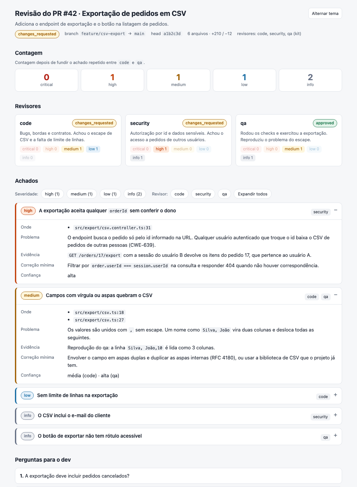

# qlt — review multiagente para Claude Code

Uma skill que faz review do diff da branch (ou de um PR) com um time de revisores especializados rodando como subagents. Você escolhe quais revisores rodar, cada fase grava um arquivo em disco e, se a sessão cair, a execução retoma de onde parou.

Os prompts e os relatórios são em português (pt-BR).

## O que faz

Ao rodar `/qlt-init-review [PR]`:

1. **Escopo:** descobre o diff (PR via `gh`, ou diff não commitado + `base...HEAD`) e grava `00-scope.md`.
2. **Escolha:** **sempre pergunta** quais revisores rodar. Nunca escolhe sozinho.
3. **Fase 1, em paralelo:** os escolhidos entre `code`, `security`, `performance` e `tests`. Cada subagent grava o próprio arquivo, então o resultado sobrevive se o coordenador cair.
4. **Fase 2:** `qa`, depois dos outros, para validar também os testes novos do `tests`.
5. **Consolidação:** achados deduplicados por severidade, contagem por revisor e um veredito único (`approved`, `changes_requested` ou `blocked`), entregues como um [relatório HTML](#o-relatório) (`90-final.html`) e um resumo em texto (`90-final.md`).
6. **Entrega:** mostra o link do relatório, ou avisa o terminal do dev no [Orca](#entrega-ao-dev-orca-opcional).

| Revisor | O que faz | Grava código? |
|---|---|---|
| `qlt-code` | Bugs, bordas, regressões, contratos de erro, padrão do repo | não |
| `qlt-security` | Injeção, authn/authz, IDOR, segredos, dependências novas | não |
| `qlt-performance` | N+1, query sem índice/limite, I/O bloqueante, O(n²) | não |
| `qlt-tests` | Escreve os testes da mudança (error paths primeiro) | só arquivos de teste |
| `qlt-qa` | Roda os checks do projeto e exercita a mudança | não |

Todo achado precisa de evidência (cenário de falha + trecho ou saída de comando). Sem evidência, não entra.

## Requisitos

| Requisito | Notas |
|---|---|
| [Claude Code](https://claude.ai/code) | Único cliente testado. Há suporte previsto para outros pela [opção 2](#opção-2-skillshare-multi-client) |
| `git` | Para o diff |
| [`gh`](https://cli.github.com/) | Só para revisar um PR (`/qlt-init-review 123`) |
| [Orca](https://github.com/stablyai/orca) | Opcional: entrega o resumo ao terminal do dev |

## Instalação

Use **uma** das opções. Misturar duas duplica os agents (`qlt:qlt-code` e `qlt-code`).

### Opção 1: plugin do Claude Code (recomendada)

No terminal:

```bash
claude plugin marketplace add glauberborges/qlt
claude plugin install qlt@qlt
```

Ou, dentro do Claude Code:

```
/plugin marketplace add glauberborges/qlt
/plugin install qlt@qlt
```

Como plugin, o comando leva o prefixo do plugin: **`/qlt:qlt-init-review [PR]`**.

```bash
claude plugin update qlt@qlt      # atualizar
claude plugin uninstall qlt@qlt   # remover
```

### Opção 2: skillshare (multi-client)

Para quem usa o [skillshare](https://github.com/runkids/skillshare) e quer o kit em vários clients de uma vez:

```bash
skillshare install glauberborges/qlt --all
skillshare sync && skillshare sync agents
```

O comando é **`/qlt-init-review [PR]`**. Claude e Cursor recebem os 5 agents. Codex, Grok e Hermes não têm pasta de agents no skillshare 0.30: nesses clients a skill lê os papéis direto da pasta de agents do skillshare e usa cada um como prompt de um subagent genérico (ou roda em sequência, se o client não tiver subagents). A retomada continua valendo, porque cada papel grava o seu arquivo.

> **Compatibilidade:** só o Claude Code foi exercitado de ponta a ponta. O suporte a Cursor, Codex, Grok e Hermes segue o desenho acima, mas ainda não foi testado nesses clients. Se algo falhar, abra uma issue.

```bash
skillshare update qlt-init-review
skillshare update agents qlt-code qlt-security qlt-performance qlt-tests qlt-qa
skillshare sync && skillshare sync agents
```

### Opção 3: cópia manual (só Claude Code)

```bash
git clone https://github.com/glauberborges/qlt.git && cd qlt
mkdir -p ~/.claude/skills ~/.claude/agents
cp -R skills/qlt-init-review ~/.claude/skills/
cp agents/qlt-*.md ~/.claude/agents/
```

O comando é **`/qlt-init-review [PR]`**. Para atualizar, faça `git pull` e repita os `cp`. Para remover, apague `~/.claude/skills/qlt-init-review` e `~/.claude/agents/qlt-*.md`.

### Depois de instalar: ignore o `.qlt/`

Os relatórios ficam em `.qlt/` na raiz da worktree e **não devem ser commitados**. Adicione ao ignore global do git (uma vez):

```bash
mkdir -p ~/.config/git && printf '.qlt/\n' >> ~/.config/git/ignore
```

Se você usa um `core.excludesFile` próprio, adicione lá. A skill confere com `git check-ignore` antes de gravar e avisa se faltar.

## Uso

```
/qlt-init-review          # diff da branch atual
/qlt-init-review 123      # PR #123
```

(Como plugin, troque por `/qlt:qlt-init-review`.)

A saída de uma execução fica em `<worktree>/.qlt/review/`; as anteriores vão para `.qlt/archive/<timestamp>/`.

| Arquivo | Conteúdo |
|---|---|
| `state.json` | Fase e status de cada revisor (base da retomada) |
| `00-scope.md` | Comando do diff, `--stat`, arquivos, `head_sha` |
| `10-code.md` · `11-security.md` · `12-performance.md` · `13-tests.md` | Um arquivo por revisor da fase 1 |
| `20-qa.md` | Fase 2 |
| `90-final.html` | Relatório visual (abre direto no navegador) |
| `90-final.md` | O mesmo conteúdo em texto, para o terminal e para agentes |
| `90-final.json` | Dados da consolidação: a fonte dos dois arquivos acima |

**Retomada:** se existir um `state.json` com `status: in_progress`, a skill mostra quem já terminou e pergunta se retoma só os pendentes ou começa do zero. Se o `HEAD` mudou desde a execução, avisa que os achados podem estar velhos e oferece refazer também os concluídos.

## O relatório

Toda execução termina com o mesmo relatório, `90-final.html`: um arquivo único, sem servidor nem dependência externa, com tema claro e escuro, filtro por severidade e por revisor e cada achado expansível (onde, problema, evidência, correção mínima e confiança). Seções sem conteúdo (perguntas, verificação do qa, regras propostas…) não aparecem.



O layout vem de [`report-template.html`](skills/qlt-init-review/report-template.html), que só tem a casca (CSS e JavaScript). O coordenador grava os dados em `90-final.json` e um comando troca uma linha do modelo por esse JSON, então o visual é sempre o mesmo e o conteúdo é escapado (um trecho de código com HTML não vira HTML). O arquivo [`examples/90-final.json`](examples/90-final.json) mostra todos os campos, com dados fictícios.

## Regras por projeto (opcional)

O `CLAUDE.md` do projeto já chega aos revisores. Para regras específicas do review, crie na raiz do projeto:

```text
.claude/qlt/common.md     # vale para todos os revisores
.claude/qlt/<dim>.md      # code.md, security.md, performance.md, tests.md, qa.md
```

Esses arquivos têm prioridade sobre o padrão do kit. Uma seção `## Ignorar` lista o que os revisores não devem reportar:

```markdown
## Ignorar
- Arquivos gerados em `src/generated/`.
- Falta de teste em `scripts/`.
```

Para um **revisor extra** (ou para sobrepor um do kit), crie `.claude/agents/qlt-<nome>.md` no projeto, no mesmo formato dos de [`agents/`](agents/). Ele aparece na pergunta como "(projeto)", e com o mesmo nome de um do kit vale o do projeto.

## Entrega ao dev (Orca, opcional)

Se você roda o review num terminal do Orca separado do terminal do dev, na mesma worktree, o coordenador espera o dev ficar ocioso (`orca terminal wait --for tui-idle`) e manda **uma linha** apontando para `90-final.md` (e `90-final.html`). Se houver mais de um outro terminal na worktree, ele não adivinha e só mostra o resumo. Fora do Orca, só mostra o resumo.

## Segurança

Os revisores **executam comandos** no seu repositório: o `qlt-qa` roda os checks do projeto (lint, build, testes) e o `qlt-tests` roda os testes que escreve. Ao revisar o PR de outra pessoa com a branch dele na worktree, isso executa o código dele. Revise PRs de fonte não confiável num ambiente isolado.

O contrato pede que os revisores não façam commit, push nem troquem de branch, e que só o `qlt-tests` grave fora de `.qlt/` (apenas arquivos de teste). Isso é instrução de prompt, não uma trava do sistema.

## Estrutura do repositório

```text
.claude-plugin/
├── plugin.json              # manifesto do plugin
└── marketplace.json         # este repo é o marketplace de si mesmo
skills/qlt-init-review/
├── SKILL.md                 # coordenador
├── contract.md              # contrato comum, injetado no prompt de cada revisor
└── report-template.html     # casca do relatório (sem dados)
agents/qlt-{code,security,performance,tests,qa}.md
examples/90-final.json       # exemplo (fictício) dos dados do relatório
docs/relatorio.png           # imagem usada neste README
```

## Desenvolvimento

- Teste local sem instalar: `claude --plugin-dir /caminho/para/qlt`. Valide os manifestos com `claude plugin validate .`.
- Para mudar o visual do relatório, edite só `report-template.html` e mantenha a linha `/*QLT_DATA*/null`, que o comando da etapa 5 do `SKILL.md` substitui pelo JSON. Para testar, rode esse comando com `examples/90-final.json` e abra o HTML gerado. Mudou um campo do JSON? Atualize o esquema no `SKILL.md` e o exemplo.
- Nomes de agent não aceitam `:` (reservado ao prefixo do plugin). Por isso `qlt-<dim>`.
- Os arquivos de saída dos revisores têm frontmatter fixo (`reviewer`, `verdict`, `counts`, `head_sha`), definido em [`contract.md`](skills/qlt-init-review/contract.md). O coordenador consolida e retoma lendo só ele: mantenha o formato.
- Sem `version` no `plugin.json`: cada commit no branch padrão vira uma atualização para quem instalou.

## Licença

MIT. Veja [LICENSE](LICENSE).
